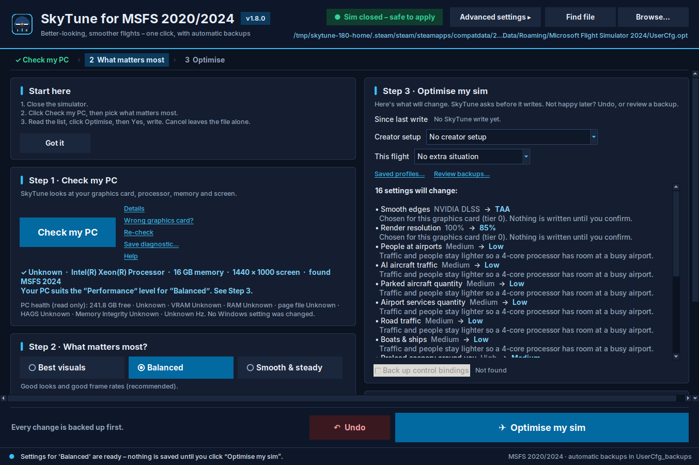
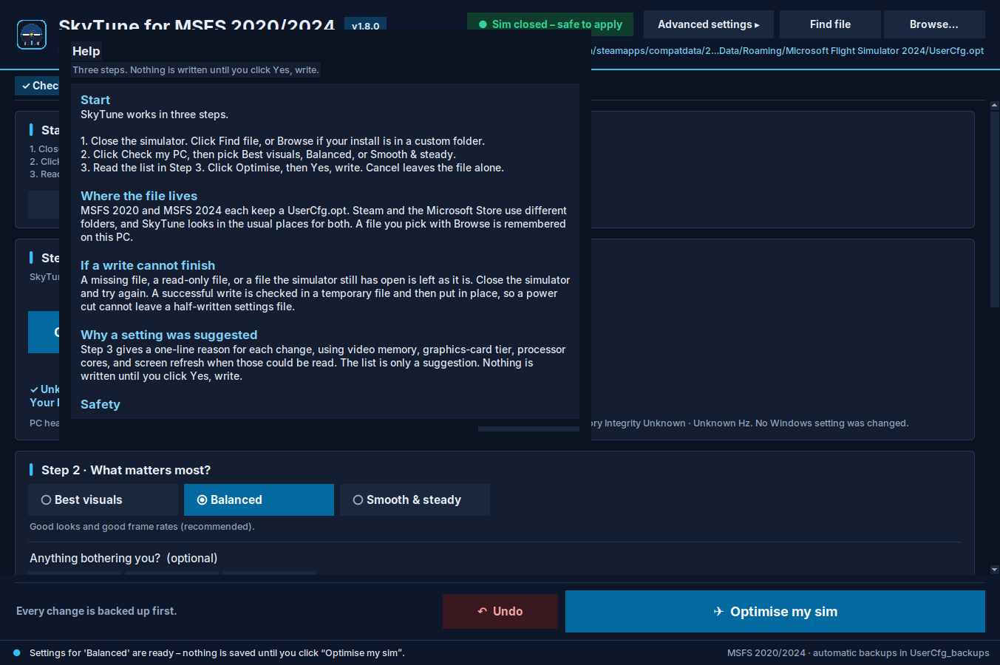
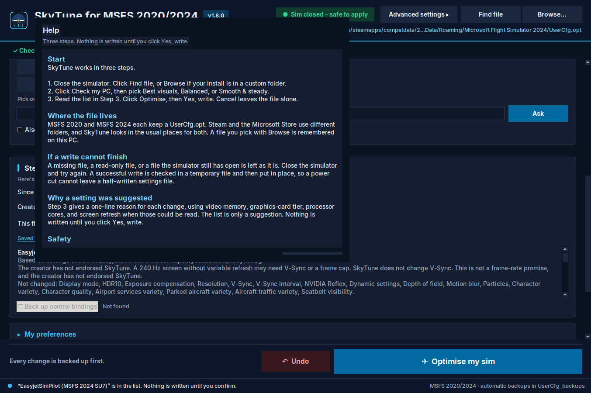

# SkyTune 1.8.2

SkyTune is a free, offline graphics tuner for Microsoft Flight Simulator 2020 and 2024 on PC. It reads your computer, shows every setting it would change, and asks before it writes. Every write keeps a backup.

Download the app from the official Flightsim.to page: [SkyTune on flightsim.to](https://flightsim.to/addon/117307/sky-tune)

It does not run on Xbox. Linux and Steam Deck are experimental, through Proton or Python.



## Features

- Three steps: check the PC, pick what matters, then read the list and confirm.
- Steam and Microsoft Store locations for MSFS 2020 and MSFS 2024, plus a custom folder you pick.
- A backup before every write, a review note, and a checked restore.
- Since last write, a sim-update check, and a read-only PC health line. SkyTune does not change Windows.
- Creator setups for MSFS 2024 based on settings shown in EasyjetSimPilot's video. The creator has not endorsed SkyTune. https://youtu.be/Mq63dyne32g
- Frame Hold, inspired by tools like AutoFPS. It works out terrain and object detail for a frame-rate target, with a minimum and maximum, and an optional altitude rule (less detail near the ground, more in cruise). MSFS does not publish a way to change those values during a flight, so Frame Hold does not write into the simulator's memory and does not change the sim while it is running. Close the sim and use Yes, write if you want the numbers saved.
- Help inside the app, and an offline assistant. Optional AI uses your own key and is off by default.
- Support pack: a zip of SkyTune's log, the PC check, and the latest before/after settings. You see the file list before it is saved, and account names are hidden.
- A read-only note when ReShade, OptiScaler, the MSFS 2024 glass-cockpit DLSS fix, or AtmosphereMod is installed and could override a saved setting. DLSS and frame generation are labelled as saved in your settings.





## Build from source

You need Python 3 with Tcl/Tk. From the `source` folder:

```
py -m pip install pyinstaller
py -m PyInstaller --onefile --windowed --name SkyTune --icon assets\app.ico --version-file assets\version_info.txt --noconfirm msfs_tweaker.py
```

Or run `build_exe.bat`. The result is `dist\SkyTune.exe`. It is unsigned. To run without building: `python source/msfs_tweaker.py`.

Tests: `cd source && python -m unittest discover -s tests`. They use temporary folders only.

## How to use AI

AI is optional and off by default. SkyTune works offline without any key. See the guide in the app if you want to add your own key.

## Disclaimer

SkyTune.exe is unsigned. Download it only from the official Flightsim.to page. Changing settings is at your own risk: SkyTune backs up your file before every write, and you should keep a copy of your own as well. Results depend on your hardware, so frame rates are not guaranteed. SkyTune is a free, independent community project, not affiliated with or endorsed by Microsoft or Asobo Studio.

The source is viewable here. Redistribution and reuse need permission from Sammy_Avgeek. See `LICENSE`.
